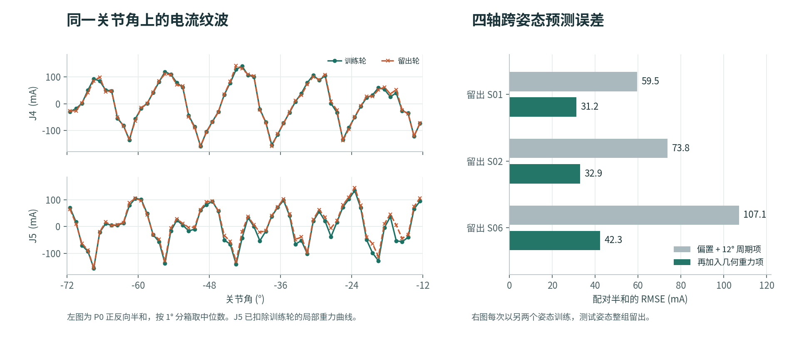

# J4 与 J5 的重力辨识和低速抑振方案

建议保留现有减速器，先处理腕部测速，再做按姿态的重力补偿和按电机相位的纹波补偿。已有实测记录支持两个判断。J4 在原 P0 姿态的重力激励很弱，改变腕姿后可以辨识出与几何重力一致的分量。J4、J5 还有约每 12° 重复一次的电流变化，单轴正弦重力模型和常数库仑摩擦都解释不了这一部分。

## 现场辨识与验收（截至 2026-11-28 05:56）

本轮先用 18 组主采冻结两轴模型，再用独立复测验收，另用未参与训练的 J4=+60° 新姿态单独验证 J5。独立复测共 6 组，每轴 3 姿态。下表电流均为指令电流，不是标定力矩；减速器原因未单独证实。复测按整姿态等权平均；旧 E 是投用重力（J4 为零、J5 用现有正弦曲线），常数摩擦 O 只作离线对照。


| 轴 | k（A/N·m） | b（mA） | 库仑（mA） | 斜率（mA/(°/s)） | 复测 E RMSE（mA，共6组，每轴3姿态） | 旧 E RMSE（mA） | 复测方向项 RMSE（mA） | 常数摩擦 O RMSE（mA） |
| --- | ---: | ---: | ---: | ---: | ---: | ---: | ---: | ---: |
| J4 | 0.9019 | +6.2 | 225 | 5.9 | 32.9 | 68.6 | 24.2 | 49.7 |
| J5 | 1.0047 | −3.0 | 165 | 5.1 | 42.6 | 140.8 | 24.8 | 34.5 |

斜率按关节角速度；换算到电机转速约 J4 70、J5 61 mA/(电机转/秒)。冻结候选在 6 组复测上均低于旧 E 与常数摩擦 O。24 组共 664213 行 MJCF 检查零失败（TCP 最低 x −84.25 mm、z 161.66 mm）；J4=+60° 新姿态另有 10237 行单独验证。[复测汇总](../results/wrist_v2_onsite_20261128_fit/summary.json) · [新旧对比](../results/wrist_v2_onsite_20261128_frozen_comparison.json) · [24 组几何检查](../results/wrist_v2_onsite_20261128_recorded_geometry.json)

J5 同一轴换腕姿后平均电流变号：J4=0° 时约 −120 mA，J4=−120°、+120° 时分别约 +52、+72 mA。J4=+60° 新姿态未参与训练，冻结模型 E RMSE 41.5 mA，低于旧曲线 76.3 mA，已作为新姿态验证通过。局限：整姿态留出 J4=0° 时，只用 J4=−120°、+120° 两个正重力姿态训练，外推到相反重力的 J4=0° 时 E RMSE 约 126 mA，误差增大；其他未验证腕姿仍需逐姿态验证。[+60 验证](../results/wrist_v2_unseen_20261128_frozen_validation.json)

现场先在 J4≈−40°、J5≈−60° 的主动位置保持下目测，未见明显下坠或漂移。另一次在 J4≈−120°、J5≈0° 的保持中，J5 编码器在约 7 秒内记录到 0.228° 峰峰值。到手推起点 J4≈+120°、J5≈−18° 后，两腕在 10.08 秒主动保持中的净位移和峰峰值均为 0°。拖动模式下的松手表现仍待记录。[摆动记录](../results/wrist_j5_hold_oscillation_20261128_0310/summary.json) · [手推起点的保持记录](../results/wrist_v2_hand_trials_20261128/j5_reference_position_hold.json)

F1 的 20 kHz 控制周期超时计数在 J4、J5 各累计 3 次，轴故障掩码均为零。计数器未记录事件时间。[计时读数](../results/wrist_v2_onsite_20261128_after24.json)

两轴新 k、b 已写入 F4 RAM 并以零比例回读：重力与实际助力输出均为 0，J4 限幅 0.12 A、J5 限幅 0.18 A。待真实同握点手推、松手 10 s 验证；F4 RAM 不持久，断电或重启后需重写。[回读记录](../results/wrist_v2_f4_zero_scale_candidate_readback_20261128.json) · [手推参考位姿](../results/wrist_v2_j5_hand_reference_20261128.json)

两块 F1 在停止位置模式下均已回读候选谐波系数，随后恢复零助力。运动中的相位、方向和拖动手感仍待实测。[F1 谐波回读](../results/wrist_v2_f1_stopped_harmonic_readback_20261128.json)

## 当前固件和实测记录（改动前基线）

| 项目 | J4 | J5 |
| --- | --- | --- |
| F4 重力输出，关节正方向 | 系数为零，运行时跳过该轴的重力计算 | `−0.010 sin(q5) − 0.120 cos(q5) + 0.005` A，角度换成弧度，限幅 ±0.18 A。运行时对所有腕姿使用同一曲线 |
| P0、1°/s 正反向配对 | 方向损耗中位数 0.250 A。扫描范围内局部正弦拟合峰峰值仅 0.024 A，拟合残差 RMS 0.084 A | 方向损耗中位数 0.182 A。训练轮、复测轮的余弦系数分别为 −0.150、−0.143 A，固定 J4 在 −30°、+30° 时分别为 −0.116、−0.115 A |
| F1 本地拖动补偿候选 | 库仑助力 250 mA | 库仑助力 185 mA |

P0 的固定关节配置为 `[0, 0, 90, 0, 0, 0]°`，采集时活动轴扫描。上表的电流均来自 F1 输出指令。离线先把电机电流换算成关节正方向，J4 取正号，J5 取负号。候选助力来自源码注释表，实机生效值取决于 F1 的 RAM 配置与 EEPROM。位置模式由重力开关控制前馈，拖动模式直接计算重力，另有 F4 的全局速度助力和 F1 的逐轴本地助力两条路径。[重力及摩擦系数](../../../2.Firmware/Core-STM32F4-fw/Robot/algorithms/gravity_compensation/gravity_compensation.cpp) · [位置和拖动路径](../../../2.Firmware/Core-STM32F4-fw/Robot/instances/dummy_robot.cpp) · [F1 候选参数和单位](../../../2.Firmware/Core-STM32F4-fw/Robot/instances/dummy_robot.h)

## 先修正腕部的速度信号

当前 F1 在每个 20 kHz 控制周期将本次编码器增量乘以频率，加上余数，右移 5 位得到速度，再扣除速度的 32 倍。每周期留下的只有整除余数。这使稳态平均速度缩小到实际值的约 1/32，低速时又会产生大量零值与短脉冲。F1 的本地摩擦助力直接读取这个速度，速度也进入位置控制器的 DCE 速度误差、超前角和部分保护判断。[速度估计与本地补偿入口](../../../2.Firmware/Ctrl-Step-Driver-STM32F1-fw/Ctrl/Motor/motor.cpp) · [定点助力和死区](../../../2.Firmware/Ctrl-Step-Driver-STM32F1-fw/Ctrl/Motor/control_math.h)

用第 2 周期正向段的首尾关节角和 F4 位置时间戳计算平均速度，再与同段 F1 速度读数的算术平均比较。

| 记录 | 角度和时间给出的速度 | F1 上报速度 |
| --- | ---: | ---: |
| J4 原 P0，1°/s | 1.001°/s | 0.995°/s |
| J5 原 P0，1°/s | 1.003°/s | 1.003°/s |
| J4 新 S01，1°/s | 0.998°/s | 0.033°/s |
| J4 新 S02，2°/s | 2.003°/s | 0.061°/s |

新批次 S01 的反向段同样给出 −1.001 和 −0.032°/s。旧 P0 和新批次应按固件版本分开分析。新批次元数据仅标记为 `current`，J5 在该批次还没有记录。当前源码可确定存在缩放问题，现场是哪一版、振动发生时哪些助力在输出，需要一次带配置的复测。若 F1 助力已经开启，间歇跨越死区会让库仑项反复加上又撤去；若发生在位置模式，则应先看 DCE 和实际前馈，F1 本地拖动助力在该模式没有作用。[新 J4 S01 记录](../data/j45_50hz/j4_s01_v1.meta.json) · [原 J5 复测记录](../results/j5_p0_v1_c5_recheck.meta.json)

## 已有数据能解释多少

使用项目现有的 `make_pairs`，按同周期、同角度、同速度幅值配对，复用默认的位置差分、加速度、故障及遥测质量筛选。定义 `E = (i正 + i反)/2`，`O = (i正 − i反)/2`。E 包含重力、方向无关的角度纹波、偏置和正反摩擦不对称的影响。O 反映方向相关的损耗。即使摩擦力很大，方向对称的部分也能在 E 中抵消；混入 E 的非对称损耗和纹波才直接妨碍重力辨识。[配对与筛选实现](../calibration.py)



**J4 的重力可观测性随腕姿显著变化。** 按项目 MJCF、闭合夹爪和机器人角度映射计算，在 P0 已配对角度上，预测保持力矩约为 −0.0014 至 +0.0010 N·m。在 S01、J5 弯至 −62.5°、J4 以 0.5°/s 扫描时，预测范围扩大到约 −0.097 至 +0.096 N·m。改变远端重心相对 J4 轴线的力臂，可以用相同设备激励出近两个数量级的差别。这里的 N·m 是几何模型先验。[重力预览及坐标映射](../gravity_preview.py)

**J4 的几何重力项能预测留出的整个姿态。** 新批次实际完成了 S01、S02 各三个速度和 S06 一个速度，共七组。以 `1、sin(30q4)、cos(30q4)` 为共同基线，再加入 MJCF 零速保持力矩一列。每轮以两个姿态训练，所有属于第三个姿态的文件都留作测试。训练时每个文件等权，测试时先求各文件的均方误差，再等权平均、开平方。下表是对 E 的预测误差。

| 留出姿态 | 偏置和周期项 | 加入几何重力项 |
| --- | ---: | ---: |
| J4 S01 | 59.5 mA | 31.2 mA |
| J4 S02 | 73.8 mA | 32.9 mA |
| J4 S06 | 107.1 mA | 42.3 mA |

三个训练折的几何系数约为 0.91–0.94 A/N·m，符号按 MuJoCo 的保持力矩定义。F4 源码用向下重力计算力矩，且几何与末端负载描述需要核对，投用前要逐姿态比对两边的力矩和电机符号。现有样本也只代表筛选后有正反覆盖的角区，例如 S01 的 1°/s 文件在默认筛选后仅覆盖约 −59° 至 −10°。新批次到 S03 的转场被碰撞检查拦下，已生成的八个姿态配置不能计作八组实测。[批采日志](../data/j45_50hz/full_batch.log) · [姿态筛选逻辑](../pose_sweep_planner.py)

**J5 已有可复现的局部重力项。** 在 P0 的另一轮完整复测上，零预测和固件现有曲线对 E 的 RMSE 分别为 102 和 65 mA。J4 为 ±30° 时，两次拟合的余弦幅值都变小，符合腕姿改变重力投影的预期。重力估错足以造成松手后的定向漂移，单靠这一项难以解释原地持续正反抖动。现有 J5 数据主要覆盖同一肩肘配置，扩大姿态域前还需要改变 J2、J3 和腕部构型进行检验。[J5 训练记录](../results/j5_p0_v1_c5_train.meta.json) · [J5 改变腕姿的记录](../results/j5_p0_j4p30_v1_c5_train.meta.json)

**两轴都有可重复的角度纹波。** 它的主周期约为输出轴 12°，恰好对应 30∶1 减速比下电机一转。以 P0 的 1°/s 完整训练文件拟合，预测另一个完整文件。J4 的 E 基线取零，J5 取训练轮的局部正弦，O 基线均取训练轮的平均损耗。分别给 E、O 各加一对 `sin(30q)、cos(30q)` 后得到下表。全部以关节角弧度计算。

| 测试文件 | E 的 RMSE，基线 → 加周期项 | O 的 RMSE，基线 → 加周期项 |
| --- | ---: | ---: |
| J4 P0，2°/s | 84.5 → 37.2 mA | 67.0 → 26.7 mA |
| J5 P0，另一次 1°/s 复测 | 65.1 → 47.5 mA | 41.5 → 25.1 mA |

这个结果支持对具体关节做相位补偿。周期本身不能区分减速器输入端偏心、装配、电机或编码器误差。实测量是闭环所需电流指令，回放误差下降也不能直接换算成手感或振幅改善。其他机器人关节已有按角度分离纹波与摩擦的实验证据。[关节纹波辨识实验](https://doi.org/10.3390/s24237465)

可用运行速度区分手感中的两种现象。12° 纹波在 1°/s 匀速时每 12 秒重复一次，速度加倍就每 6 秒重复一次。若卡顿随角度重现，优先验证相位补偿。若接近静止仍快速来回抖，或振动频率基本不随扫描速度变化，应同步观察助力符号翻转、位置误差与输出端振动。关闭助力后继续出现固定频率的窄峰，再用更高采样率检查位置环增益或结构共振。当前异步 USB 遥测适合慢速配对，高频诊断应使用 F1 本地等间隔记录或外部传感器。

## 当前可复跑离线模型

`fit_wrist.py` 只枚举同名 `.meta.json` 同时记录 `completed=true` 和 `stop_acknowledged=true` 的 J4/J5 数据。文件按 F4 revision 与实际 hash、归一化载荷描述、显式 `payload_identity` 和配置夹爪开度分组，载荷文本末尾的 `J4=<角度>` 姿态标注不拆成不同载荷。因此新增连线的相机 J5 数据不会与 `camera data cable unplugged` 组混合。每个文件独立调用传统四列 `make_pairs`，得到方向半和 `E`、半差 `O` 和正反向速度幅值的平均值。训练时每个独立轮的总权重相同。

模型对每个数据组使用其实际配置 `gripper_rad` 计算当前 `scene.xml` 的全部六轴零速 `qfrc_bias`，作为该组的 `tau_hold_Nm`；同组夹爪值不一致或越界会拒绝。当前无别物现场使用闭合值 `gripper_rad=0`，但离线拟合不会把不同夹爪开度悄悄当成同一模型。J4/J5 的 `q_robot_deg` 直接来自 F4，`initPose` 已包含，因此关节相位为 `phi=30*q_robot_rad`，不另加零位。E/O 分别拟合一阶 `sin(phi)`、`cos(phi)`。O 同时尝试常数和粘滞项。是否加入速度项以元数据中的真实指令速度分层，而不是以筛选后的实测速度唯一值伪增分层；每个留出折只用训练折决定是否加入，再固定该选择预测测试折。还要求至少两个指令速度、跨度不小于 0.2°/s 和最大指令速度的 10%、系数为正、95% 区间不跨零且 BIC 改善超过 2。负粘滞系数不会进入可部署公式。

```text
E = k*tau_hold_Nm + bias + E_sin*sin(phi) + E_cos*cos(phi)
O = odd_constant + odd_speed*abs(speed_deg_s) + O_sin*sin(phi) + O_cos*cos(phi)
i_joint_positive = E + direction*O
i_motor = motor_sign[i]*i_joint_positive
```

当前合格数据产生两个候选。J4 组有 `J4_S01`、`J4_S02`、`J4_S06` 三个整姿态和七个独立轮。其 `k=0.9343 A/N·m`，95% 区间 `[0.9081,0.9604]`，偏置 `0.01006 A`。速度项 `0.01054 A/(°/s)`，标准误 `0.000954`，被纳入 O。整姿态留出得到 E/O 的宏平均 RMSE `35.43/32.07 mA`，独立轮留出为 `33.26/28.39 mA`。

J5 组有 `P0`、`J4=-30°`、`J4=+30°` 三个整姿态，但每个姿态只有 1°/s 左右的记录。其 `k=0.9495 A/N·m`，95% 区间 `[0.9119,0.9870]`，偏置 `0.00315 A`。速度跨度仅约 `0.03°/s` 且 BIC 未改善，故不纳入速度项。整姿态留出得到 E/O 的宏平均 RMSE `46.45/26.49 mA`，独立轮留出与整姿态留出等价，因为每个姿态只有一轮。J5 的方向常数 `0.1772 A`，一阶转纹波在关节正方向为 `+0.04119 sin(phi)`、`+0.02212 cos(phi) A`。

关节相位表达与 F1 电机相位不能混用。`model.motor` 保持为“关节角 `phi` 和关节方向 `dir_joint` 表达后再乘 motor 符号”的带符号中间式，不能把其中每个系数整体乘 `-1` 后当成 F1 参数。F1 的真实相位是 `psi = s*phi`，运动方向是 `dir_motor = s*dir_joint`，J4 `s=+1`、J5 `s=-1`。因此导出 `motor_phase` 的四谐波按 `(E_sin, E_cos*s, O_sin*s, O_cos)` 转换。对 J5，只有 `E_cos` 和 `O_sin` 反号，`E_sin`、`O_cos` 不反号。gain=100% 时导出未缩放 mA 原值与最近整数，正好半值时远离零。库仑项为 mA，粘滞项为 mA/(motor rev/s)。J5 现有单速数据必须保持粘滞项不可部署。F1 相位以编码器 home 为参考，本拟合尚未独立识别该 home 对关节角的相位偏移，实机投用前必须验证相位和符号。

结果在 [`../results/j45_offline_fit_candidates_v2/`](../results/j45_offline_fit_candidates_v2/)，包含模型、配对证据、输入哈希和总清单。脚本默认拒绝覆盖非本工具管理的文件，连续重跑的训练结果和模型哈希一致。清单更新只保留仍位于输出目录中的旧管理文件，不再删除旧清单列出的任何输入路径。所有模型仍为 `enabled=false`，只证明离线模型对现有整姿态和独立轮有预测能力，没有验证 F1 前馈、实际保持误差、温升、振动或手感。

现有 J4 组的一份固定姿态实测 J5 为 `100.01°`，比名义边界多 `0.01°`。离线路由仅允许 `0.05°` 的测量/控制舍入容差并在模型中报告该超出量；实机入口仍严格拒绝超出名义边界的起点。其他合格组只有一个姿态，不能完成整姿态留出，因此没有生成部署候选。

## 实施顺序

1. **建立振动基线并验证测速。** 先记录发生振动的控制模式、固件构建标识、实际生效的 F1 本地系数、F4 拖动增益和前馈状态。`#GETDRAG` 能读 F4 状态，F1 端建议补有效参数读回。将原始电机角、速度、位置目标、反馈电流、重力项、本地摩擦项和限幅状态在同一 F1 周期锁存或对齐，短时缓存后导出。用相同姿态区分位置保持、位置低速往复、手动拖动及松手。拖动振动优先做单轴摩擦助力的开关对照，保持相同重力和支撑条件。当前全局 `#DRAG_GAIN` 会作用于六轴，独立试验应采用逐轴屏蔽。
2. **给腕部助力单独提供可信速度。** 先并行计算候选速度 `v[k] = (θ[k] − θ[k−N])/(N·Ts)`，θ 取解绕后的电机角，定点计算。用编码器计数和实测静止噪声选窗口，也检查换向延迟。先在 J4/J5 记录两路信号，用正负匀速、静止、反转验证速度积分与位移一致，再接入这两轴的本地助力。DCE、超前角和超速保护共享原速度，改变共享路径前要独立回归位置控制和保护。速度直接乘 32 会同时放大单拍脉冲。
3. **把重力和纹波分别辨识。** 在 F4 计算全姿态 J4/J5 的几何保持力矩，为每个腕轴拟合电流比例和偏置。以当前 J5 曲线、J4 零重力为工程基线。先同时估计几何重力及 E 的一阶相位项，避免把纹波拟成重力。选姿态时在可达、无碰撞的扫描段和转场内，优先覆盖预测力矩为正、接近零、为负的情况，并让不同腕姿扫描共同角区。对 J4 改变 J5 弯曲角及肩肘姿态，对 J5 改变 J4 及肩肘姿态。固定工具和线束，另用已知质量、已知偏心的负载重复少数构型，比较重力变化的方向与量级。用实际位置时间戳分段估速，按角度和周期均衡加权，留出整个腕姿、速度和冷暖轮次检验；激励充足且比例模型仍有系统误差时，再拟合工具质量一阶矩的可辨识组合。

六路线补采由 `wrist_supplement_plan.py` 使用内置 `EXPECTED_ROUTES` 和共用起点 `[-90,-16,110,0,0,0]°` 生成，不默认读取历史证据。J4 固定 J5 为 `-60/0/+60°`。J5 固定 J4 为 `-120/0/+120°`，两者均扫 `[-40,40]°`。主采含 `0.5/1/2°/s`，独立复测含 `1°/s`，夹爪闭合为 `0 rad`、空载、相机已装且数据线接着。生成器每次核验当前 MJCF 的地面/自碰撞/TCP 和全部转场，只写不存在的输出目录。两个实际 HEX 可一次传入并记录各自及组合 SHA-256，现场限流、固件 revision 和 `operator_reviewed_workspace` 仍须由操作者复核。
4. **在 F1 按运动状态逐步补偿摩擦。** 首版对 E、O 分别拟合电机一转的一阶正余弦，用 O 的常数和速度项描述平均摩擦，运动时按方向合成。先在位置轨迹回放和闭环中验证相位与符号，F4 负责慢变重力，F1 负责低延迟的相位和摩擦修正。拖动时采用静止、正向运动、反向运动三个状态。静止只给通过验证的重力并撤去主动摩擦助力，同向位移和速度持续超过启动阈值后才渐入部分助力，退出阈值低于启动阈值，反向前先退回零助力。单独限制修正电流幅值及斜率，保留净耗散和小正阻尼。已有 F1 死区和库仑渐入可以复用，新增的是方向确认、迟滞与按相位的幅值。避免 F4 和 F1 对同一腕轴重复助力，保留总限流、租约失效及退出保持。高阶谐波、分方向查表或 Stribeck 模型只在增加参数后仍能改善整轮留出结果时采用。[本地补偿实现](../../../2.Firmware/Ctrl-Step-Driver-STM32F1-fw/Ctrl/Motor/control_math.h) · [摩擦过补偿与极限环实验分析](https://elib.dlr.de/55742/1/LeTienIROS2008.pdf)

## 2026-11-28 实机拖动手感对照（J5）

本节记录断电后恢复通信、F4 RAM 参数与手推验收的最新结果。所有手推均由同一握点完成，位置与助力来自 F4/F1 遥测，手感为操作者主观判断；没有推拉力计，因此不报告启动力或连续拖动力的绝对数值。

### 安全与数据链修正

- 新增 `wrist_drag_trial.py` 的 J1/J2/J3/J6 与另一腕轴独立边界。手推时 J1、J3 会因整机耦合产生超过 1° 的联动；实际联动已纳入 MJCF 走廊预检和在线校验，不能再用单一 1° 边界。
- 修复 `#GETWRIST` 在 CAN 查询超时后的安全重试，并要求先读到完整的 enabled/mode 5 状态；静默 USB 超时或畸形回复不重试。
- `#GETTELEM` 与 `#GETSTATUS` 必须按事务消费，六轴快照检查 F4 tick 年龄，避免延迟遥测污染速度、姿态和覆盖判断。
- 78 项 GravityCalibration 单元测试通过，`git diff --check` 通过。固件未改动，本轮参数写入 F4/F1 RAM，断电后不保留。

### 无人接触基线

起手点 J4≈+120°、J5≈−18.65°、夹爪闭合空载、相机及数据线安装。每档至少记录 10 s 松手窗口。

| 配置 | J5 10 s 峰峰值 | 备注 |
| --- | ---: | --- |
| 新重力、摩擦全关 | 0.0265° | 初始基线 |
| 重力 10%、摩擦关 | 0.0035° | 重力比例试加 |
| 重力 25%、摩擦关 | 0.0021° | 重力比例试加 |
| 重力 50/75/100%、摩擦关 | 0.0061/0.0016/0.0023° | 均未见自激 |
| 重力 100%、摩擦 30%、谐波零 | 0.0030° | 可进入低速助力 |

这些结果只说明该姿态下没有由助力造成的持续自激，不能证明减速器输出端回差已经消失。

### 手推对照

| 组 | J5 重力/摩擦/谐波 | 记录范围 | 助力回读 | 操作者结论 | 数据 |
| --- | --- | --- | --- | --- | --- |
| A 组 | 冻结重力、无新摩擦 | −20.30°～+7.62° | 0 | J3 联动越界抱紧，非自激 | `j5_hand_a2.csv` |
| B 组 | 重力 100%、摩擦 15%、谐波零 | −20.30°～+7.62° | ±35 mA | 明显改善但仍能感觉卡点 | `j5_hand_b15.csv` |
| C 组 | 重力 100%、摩擦 30%、谐波零 | −21.26°～+0.99° | ±55 mA | 慢推和换向改善，仍有卡点 | `j5_hand_c30.csv` |
| D 组 | 重力 100%、摩擦 15%、冻结谐波 | −21.54°～+18.45° | ±45 mA | 更顺但仍有卡点 | `j5_hand_d15c.csv` |
| E 组 | 重力 100%、摩擦 100%、冻结谐波 | −38.93°～+10.96° | 0 | 更顺但 12° 卡点仍在；助力未进入 | `j5_hand_e100b.csv` |

C 组 10 s 松手峰峰值 0.0014°，J5 没有自走。B/C/D 的腕部助力确实进入 ±35～55 mA，且多数帧方向与关节速度一致。E 组进入拖动后回读 `f0.000`，说明 F1 方向确认和死区在当前测速下没有让 100% 增益生效，因此该组主观改善不能归因于 100% 摩擦增益。

### 结论与下一阶段

1. 重力补偿已验证。J5 新重力比例从 0.10 增加到 1.00 时，无人接触窗口无漂移或自激；C 组完整松手窗口仅 0.0014° 峰峰值。
2. 摩擦补偿有效但会放大过冲。B/C 组在关节速度达到数十度每秒时仍出现接近 ±35/55 mA 的助力，且少量帧因 F1 方向状态更新滞后出现反向。后续应降低粘滞斜率、保留较小库仑项，并延长换向确认窗口，而不是继续提高总增益。
3. 冻结谐波相位尚未完成硬件零位标定。D 组加入冻结谐波后更顺，但 E 组 100% 增益未真正进入。离线相位 `psi=30*q_joint` 与 F1 编码器 home 参考相位的关系仍未独立识别；在相位零位确认前，不宜把冻结谐波作为最终参数。
4. 当前 12° 卡点同时受减速器加工一致性、扭矩纹波、方向死区和固件相位基准影响。算法还有明确可做的验证：F1 本地等间隔高速记录、相位零位扫描、小库仑项配不同谐波幅值、降低速度项后的重复手推。
5. 更换哈默减速器仍作为算法和相位验证无效后的下一册。现有证据已经排除了“J5 完全不受重力影响”和“重力补偿必然造成自激”两种解释，但尚无输出端角度计，不能将电机编码器稳定性等同于输出端无回差。

## 验收和更换减速器的条件

每次只改变一项，在相同工具、姿态、速度和温度条件下对比。先验证速度，再比较重力单独开启，接着加相位项，最后逐步增加运动中的摩擦助力。用腕部参考标记加视频或外置角度计观测输出端，电机编码器换算位置会漏掉减速器间隙内的运动。首轮可采用以下工程目标，最终绝对门槛以整机允许的漂移、手推力和位置精度确定。

| 工况 | 建议记录和通过条件 |
| --- | --- |
| 匀速正反转 | 速度均值与逐段位移/时间误差先控制在 10% 内，静止噪声和反向延迟能支持选定的迟滞阈值 |
| 多姿态保持与松手 | 记录松手后 10 s 的净漂移、输出角峰峰值及持续反向次数。各代表姿态均无持续自激，振幅和漂移低于预先规定的机械臂使用容差 |
| 低速运行 | 对比同一轨迹的输出端速度波动、位置误差、电流周期分量和饱和时长。可先以振幅或速度波动较原基线下降 50% 作为目标，同时检查换向冲击和峰值电流 |
| 拖动手感 | 同一力臂用测力计分别记录启动峰值、连续拖动力及正反差。松手稳定和启动力均需达标，不能仅靠增加阻尼压低振幅 |

如果关掉主动助力仍在同一角度卡顿，而纹波相位稳定，仍值得做个体标定。如果在测速、重力和纹波补偿验证后，输出端实测回差已超过位置容差，或冷暖、换向后的启动峰值离散到“足以推过卡点”的助力会在顺滑区或松手时造成自走，现有传感器和算法就很难同时满足精度、手感与稳定性。先排除线缆牵拉、安装偏心和预紧异常，再考虑更换哈默减速器，用同一套工况和测量方法做前后对照。
